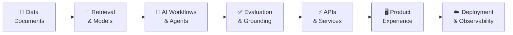
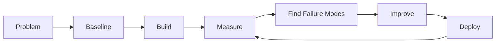

<div align="center">
    
# Hi, I'm Bijay Thakur 👋

### AI Engineer · Applied ML · Full-Stack AI Systems

I build **grounded, evaluated AI systems** — from retrieval and model pipelines  
to backend APIs, observability, deployment, and polished product experiences.

📍 New York, USA &nbsp; • &nbsp; 🎓 Computer Science @ Queens College, CUNY · Dec 2026  
🤖 AI Engineering &nbsp; • &nbsp; 🧠 Applied ML &nbsp; • &nbsp; ⚙️ Production AI

<br />

<a href="https://github.com/Bijay-Thakur"></a>
<a href="www.linkedin.com/in/bijay-thakur-6b7793258"></a>
<a href="https://bijaythakur.vercel.app/"></a>
<a href="mailto:starbijay143@gmail.com"></a>

</div>

---

## 🧭 What I Build

I enjoy working across the complete AI engineering lifecycle rather than treating the model as the entire product.



> **My focus:** building AI systems whose behavior can be observed, evaluated, measured, and improved — not just demos that call an LLM API.

---

## 🧰 AI Engineering Toolbox

<table>
<tr>
<td width="25%" valign="top">

### 🧠 AI & ML


</td>
<td width="25%" valign="top">

### 🤖 LLM Systems


</td>
<td width="25%" valign="top">

### ⚙️ Backend & Data


</td>
<td width="25%" valign="top">

### 🚀 Product & Infra


</td>
</tr>
</table>

---

## 🚀 Featured Engineering Work

<table>
<tr>
<td width="50%" valign="top">

### 🎯 RivalScope AI

**Source-grounded competitive intelligence system**

Researches companies across parallel tracks, verifies evidence, produces structured comparisons, and exposes the workflow through live traces.

**Engineering highlights**

- Fixed LangGraph orchestration
- 4 parallel research tracks
- Source-grounded evidence pipeline
- SSE workflow streaming
- Evaluation harness and SQLite persistence
- Optional LangSmith tracing
- **129 backend pytest cases**

**Stack:** `Next.js` `FastAPI` `LangGraph` `Tavily` `Groq` `Gemini`

[**View Repository →**](https://github.com/Bijay-Thakur/RivalScope-AI)

</td>
<td width="50%" valign="top">

### 📑 SEC Insight AI

**Citation-grounded RAG over SEC 10-K filings**

Production-oriented financial document QA with hybrid retrieval, reranking, answerability detection, deterministic calculations, evaluation, and deployment controls.

**Engineering highlights**

- BM25 + dense vector retrieval
- Reciprocal Rank Fusion
- Cross-encoder reranking
- Citation-grounded generation
- Cost and quota controls
- Docker + Google Cloud Run
- **50-question evaluation set**
- **0.99 RAGAS faithfulness · 0.88 Recall@5**

**Stack:** `FastAPI` `Next.js` `ChromaDB` `OpenAI` `Supabase` `Docker`

[**View Repository →**](https://github.com/Bijay-Thakur/rag-sec-10k)

</td>
</tr>
<tr>
<td width="50%" valign="top">

### 👁️ GlitchVision

**Visual anomaly detection for gameplay QA**

CPU-first visual anomaly triage that identifies suspicious frames and gameplay segments without requiring a large labeled dataset.

**Engineering highlights**

- ResNet-18 embeddings
- Isolation Forest
- Reference-bank kNN
- Hybrid anomaly scoring
- Segment-level analysis
- Benchmarking and profiling

**Stack:** `Python` `PyTorch` `scikit-learn` `Computer Vision` `Streamlit`

[**View Repository →**](https://github.com/Bijay-Thakur/GlitchVision---Visual-Anomaly-Detection-for-Game-QA)

</td>
<td width="50%" valign="top">

### 🧪 LaunchLab AI

**Multi-LLM Product Studio**

Transforms an initial product idea through research, product architecture, build planning, campaign generation, and evaluation.

**Engineering highlights**

- Manual orchestration vs. LangGraph
- Gemini + OpenAI routing
- Shared workflow state
- Per-stage provider fallback
- Structured model outputs
- Full-stack product UI

**Stack:** `Next.js` `Flask` `LangGraph` `OpenAI` `Gemini`

[**View Repository →**](https://github.com/Bijay-Thakur/LaunchLab-AI---Multi-LLM-Product-Studio)

</td>
</tr>
</table>

---

## 📊 Engineering Evidence

<div align="center">

| **129** | **50** | **0.99** | **0.88** | **4** |
|:---:|:---:|:---:|:---:|:---:|
| Backend Tests | RAG Eval Questions | RAGAS Faithfulness | Recall@5 | Parallel Research Tracks |

</div>

These are the signals I care about most: **tests, evaluation, grounding, observability, architecture, latency, cost, and deployment trade-offs.**

---

## 🌱 Open Source

### PathReview Contributor

Contributed a reliability fix to a RAG evaluation pipeline by safely handling nullable context-chunk text and adding regression coverage. The change was validated with unit tests, linting, formatting, and static type checking.

> Learning open-source engineering through real code review, contribution standards, testing, and pull-request workflows.

---

## 🔬 How I Approach AI Engineering



I try to answer questions like:

- **How do we know the system works?**
- **Where does it fail?**
- **Is retrieval actually helping?**
- **What should be deterministic instead of LLM-generated?**
- **What is the latency/quality trade-off?**
- **How do we prevent unsupported answers?**
- **How will this behave with real users?**

---

## 🎓 Currently Going Deeper

<table>
<tr>
<td width="33%" valign="top">

### Machine Learning

- Neural networks from first principles
- Optimization and backpropagation
- Model evaluation
- Computer vision
- NLP

</td>
<td width="33%" valign="top">

### LLM Engineering

- Transformers
- Retrieval systems
- Reranking
- Evaluation
- Fine-tuning
- Inference

</td>
<td width="33%" valign="top">

### Software Engineering

- System and API design
- Testing
- Databases
- Concurrency
- Deployment

</td>
</tr>
</table>

---

## 🧩 More Projects

| Project | Focus |
|---|---|
| [**AI Podcast Generator**](https://github.com/Bijay-Thakur/AI-Podcast-Generator) | Generative AI + audio |
| [**Code Council**](https://github.com/Bijay-Thakur/Code-Council---A-Multi-Agent-GenAI-Code-Analysis-System) | Multi-agent code analysis |
| [**StoreSense**](https://github.com/Bijay-Thakur/StoreSense---AI-Profit-Leak-Assistant-for-Small-Stores) | Applied AI for small businesses |
| [**TakeMeter**](https://github.com/Bijay-Thakur/ai201-project3-takemeter) | NLP classification + fine-tuning |
| [**MarianMT Domain Adaptation**](https://github.com/Bijay-Thakur/marianmt-en-fr-domain-adaptation) | Machine translation |

---

## 🎯 Current Focus

```text
Production AI
├── LLM systems
├── Retrieval and reranking
├── Evaluation
├── Model inference
├── Backend engineering
├── System design
└── Deployment and observability
```

> **My goal: understand the system deeply enough to build it, measure it, explain its trade-offs, and ship it.**

---

<div align="center">

## 🤝 Let's Connect

I'm especially interested in **AI Engineering, Applied ML, GenAI infrastructure, RAG systems, AI agents, and production ML systems.**

<br />

<a href="www.linkedin.com/in/bijay-thakur-6b7793258"></a>
<a href="https://bijaythakur.vercel.app/"></a>

<br /><br />

### Build systems. Measure them. Improve them. Ship them.

<sub>Thanks for visiting 👋</sub>

</div>
