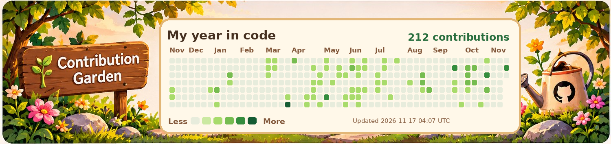
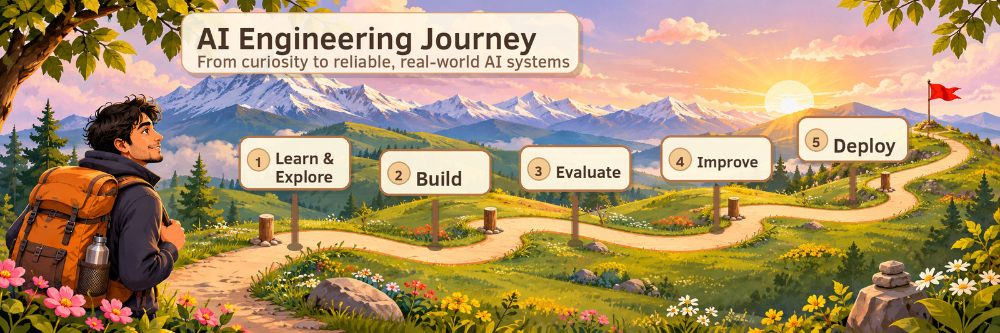
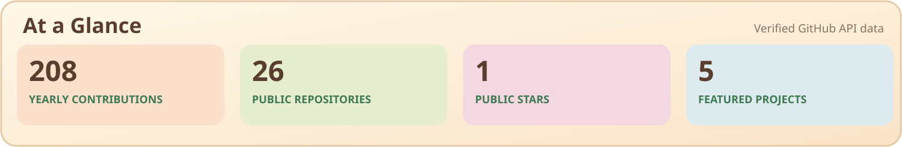
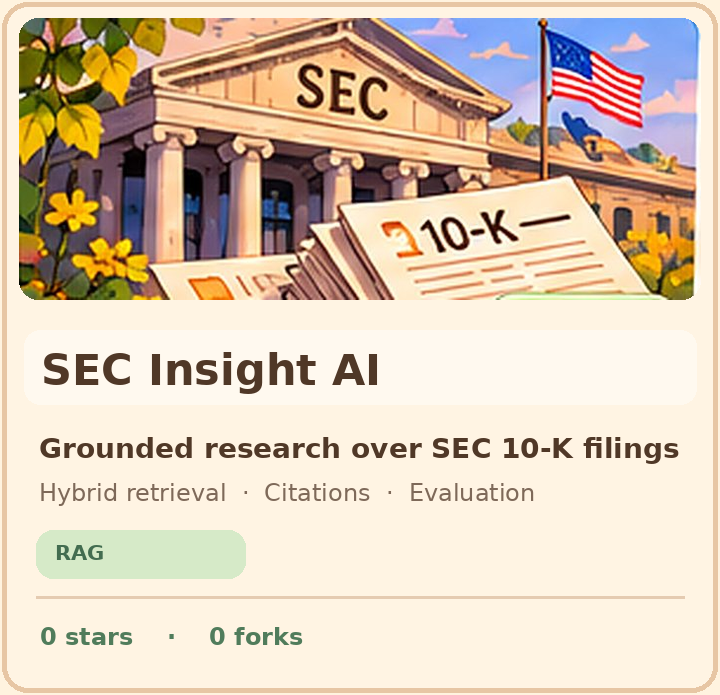
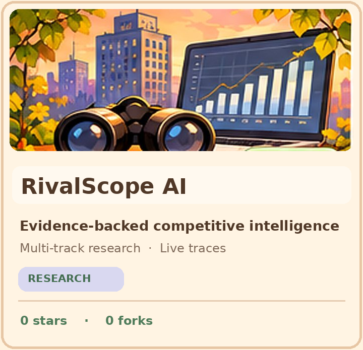
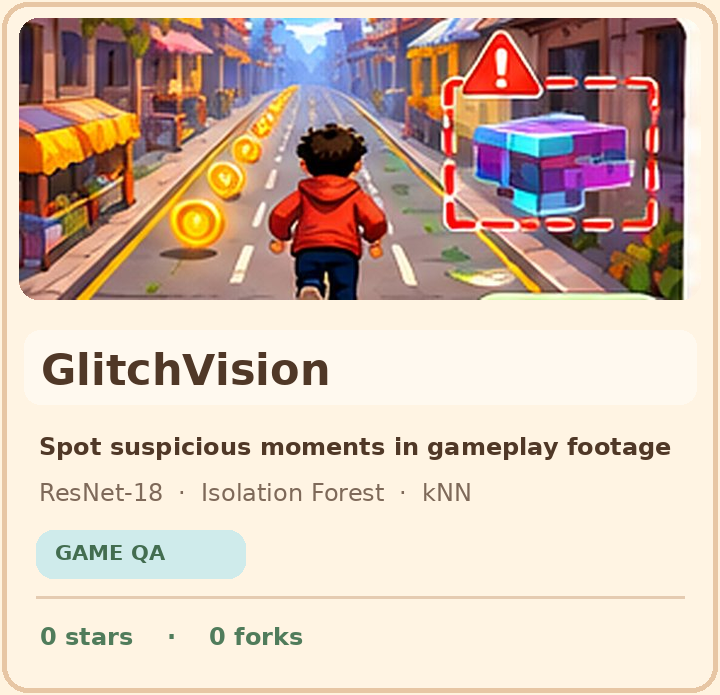
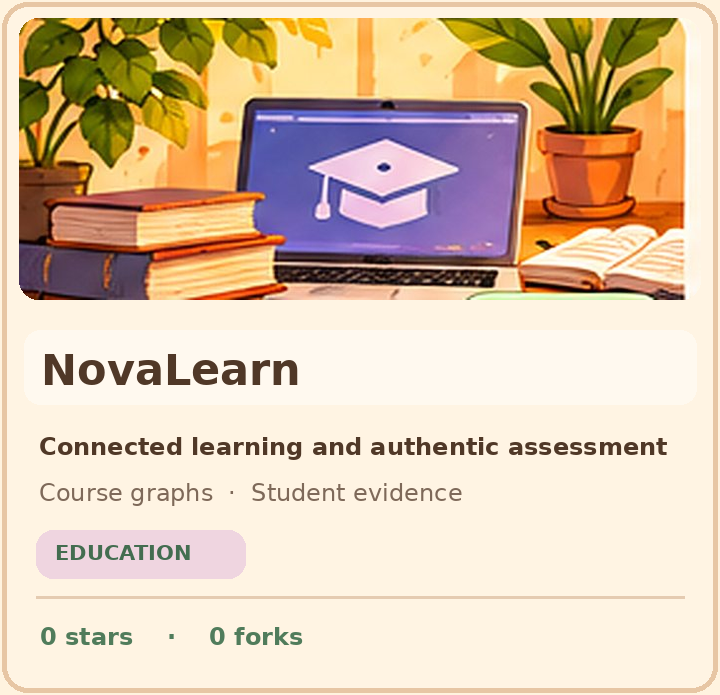
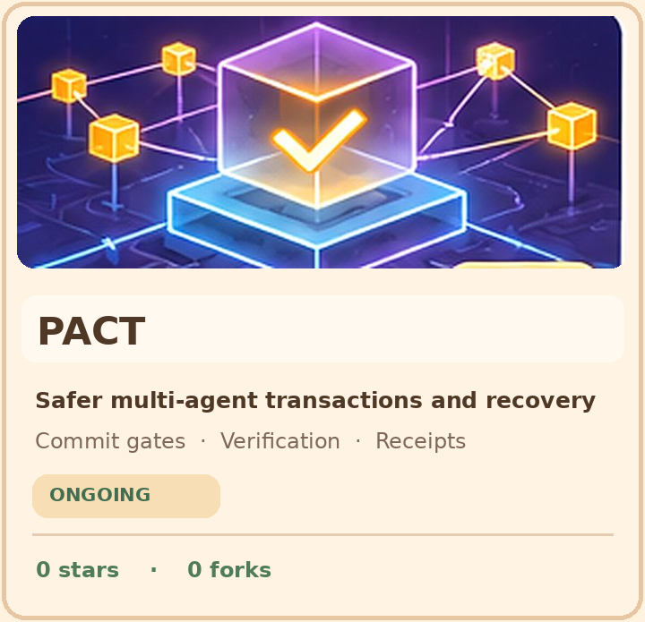

  
  
  

### 🌱 GitHub Activity · Contribution Garden

Contribution squares and totals come from GitHub's verified contribution calendar. The workflow targets updates about every 30 minutes; GitHub scheduling and image caching may cause delays. The banner shows its last successful refresh time.

### 🏔️ My AI Engineering Journey

Learn & Explore → Build → Evaluate → Improve → Deploy

### 📊 At a Glance

<!-- STAR_PROVENANCE_START -->

<strong>⭐ Where do the public stars come from?</strong> <a href="https://github.com/Bijay-Thakur/StoreSense---AI-Profit-Leak-Assistant-for-Small-Stores">StoreSense---AI-Profit-Leak-Assistant-for-Small-Stores — 1 star</a> Verified GitHub public repositories. This is stars received, not repositories starred by me.

<!-- STAR_PROVENANCE_END -->

### ✨ Featured Projects — made with care

*Illustrated using artwork from my Cozy Studio reference design. Each card opens its actual GitHub repository.*

These are real public repositories, each card opens its source code. **PACT is ongoing.** Stars and forks are read from GitHub and refreshed by Actions; no unsupported accuracy, test-count, production-readiness, or evaluation claims are displayed.

### 🛠️ Tools around my desk

AI & machine learning · APIs & data · Frontend · Cloud & deployment

