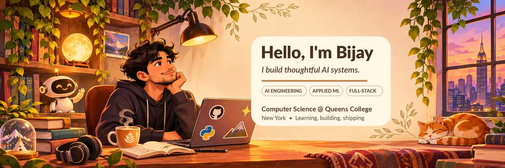
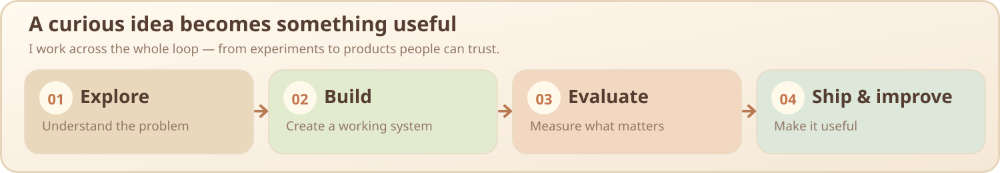
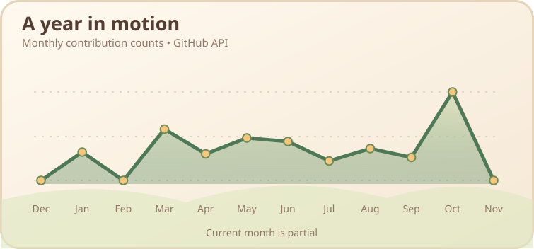
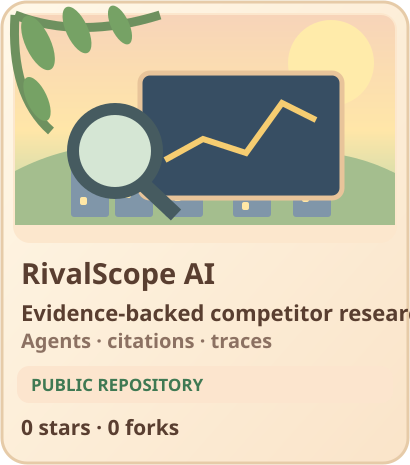
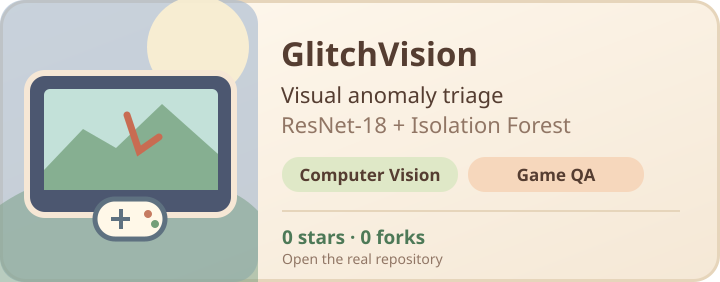
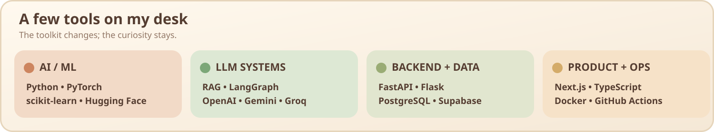
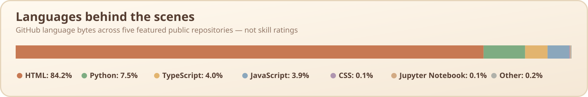

**Hi, I'm Bijay.** I turn curious ideas into thoughtful AI systems and useful products.

`AI engineering` &nbsp;·&nbsp; `Applied ML` &nbsp;·&nbsp; `Full-stack building` &nbsp;·&nbsp; `New York`

### 🌿 A little about my work

CS @ Queens College, CUNY · Interested in building AI systems that are grounded, measured, and useful in the real world.

### ☀️ My little corner of GitHub

<!-- Auto-generated from public GitHub APIs; updated daily by GitHub Actions. -->

### ✨ Things I've been building

  
  
  
  
  

These are real repositories. Stars, forks, and repository languages are refreshed automatically — not invented badges.

### 🎨 My toolbox

### 🔧 On the workbench

**PACT — an ongoing project.** I'm exploring transaction safeguards for AI agents: delegated authority, commit validation, recovery, and verifiable outcomes. [Follow PACT's development](https://github.com/Bijay-Thakur/PACT---Protocol-for-Agentic-Commit-Transactions).

### 🌱 Currently growing

**More thoughtful retrieval. Better evaluation. Reliable agents. Delightful software.**

I'm especially interested in the place where model engineering meets real product engineering.

**Thanks for stopping by — there's always room for another builder at the table.** ☕

