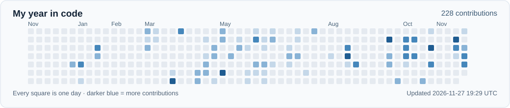

# Bijay Thakur

**AI Engineer · Applied ML · Software Builder**  
Computer Science, Queens College (CUNY) · New York, USA

I build practical AI systems that connect **retrieval, agents, evaluation, and full-stack engineering**. I care about what happens beyond a compelling demo: evidence quality, system behavior under failure, and whether people can actually use what I build.

[**Portfolio ↗**](https://bijaythakur.vercel.app/) &nbsp;·&nbsp; [**LinkedIn ↗**](https://www.linkedin.com/in/bijay-thakur-6b7793258/) &nbsp;·&nbsp; [**Email ↗**](mailto:starbijay143@gmail.com) &nbsp;·&nbsp; [**Repositories ↗**](https://github.com/Bijay-Thakur?tab=repositories)

---

### What I work on

`Applied AI` &nbsp; `RAG & Information Retrieval` &nbsp; `AI Agents` &nbsp; `Evaluation & Reliability` &nbsp; `Full-stack Systems`

My approach: **define the problem → design the system → build → evaluate → iterate**. I enjoy projects where the difficult part is not just calling a model, but making the result understandable, verifiable, and useful.

### Featured engineering work

#### [01 / SEC Insight AI](https://github.com/Bijay-Thakur/rag-sec-10k) · Financial document intelligence

**Problem:** Financial filings are long, difficult to search, and easy to misinterpret without supporting evidence.  
**Approach:** Citation-grounded Q&A over a bounded SEC filing collection, with lexical retrieval, answerability checks, a FastAPI service, and a Next.js interface.  
**Engineering focus:** Retrieval provenance, evaluation, cost controls, and safe behavior when a verified semantic index is not available.  
**Stack:** `Python` `FastAPI` `Next.js` `OpenAI` `ChromaDB`  
[Source & technical documentation ↗](https://github.com/Bijay-Thakur/rag-sec-10k) · [Web interface ↗](https://rag-sec-10k-alpha.vercel.app)

#### [02 / RivalScope AI](https://github.com/Bijay-Thakur/RivalScope-AI) · Competitive research agents

**Problem:** Competitor intelligence is often scattered across web sources, and uncited summaries are hard to trust.  
**Approach:** A LangGraph research pipeline with parallel evidence-gathering tracks, citation-backed comparisons, streaming execution traces, and a benchmark harness.  
**Engineering focus:** Traceability, grounding checks, deterministic scoring, and repeatable evaluation in mock mode.  
**Stack:** `Python` `FastAPI` `LangGraph` `Next.js` `Tavily`  
[Source & architecture ↗](https://github.com/Bijay-Thakur/RivalScope-AI)

#### [03 / GlitchVision](https://github.com/Bijay-Thakur/GlitchVision---Visual-Anomaly-Detection-for-Game-QA) · Computer vision for game QA

**Problem:** Manually reviewing long gameplay recordings to find unusual visual events is time-consuming.  
**Approach:** CPU-first frame sampling, ResNet-18 embeddings, Isolation Forest, reference-based kNN, and ranked suspicious intervals.  
**Engineering focus:** Baseline comparisons and reproducible synthetic evaluation. The system flags **where to review**, not a definitive diagnosis of what is broken.  
**Stack:** `Python` `PyTorch` `scikit-learn` `Streamlit`  
[Source & benchmark methodology ↗](https://github.com/Bijay-Thakur/GlitchVision---Visual-Anomaly-Detection-for-Game-QA)

#### [04 / NovaLearn](https://github.com/Bijay-Thakur/Nova-Learn) · AI-assisted course design

**Problem:** Course materials, assessments, learning objectives, and evidence of understanding can be disconnected.  
**Approach:** A professor-led workspace for generating course structures, reviewing authentic assessments, and tracing student evidence to learning objectives.  
**Engineering focus:** Human approval gates, explicit preview/live boundaries, immutable evidence records, and recoverable workflows.  
**Stack:** `Next.js` `TypeScript` `Supabase` `LLM APIs`  
[Source & implementation guides ↗](https://github.com/Bijay-Thakur/Nova-Learn)

#### [05 / PACT](https://github.com/Bijay-Thakur/PACT---Protocol-for-Agentic-Commit-Transactions) · **Ongoing research prototype**

**Problem:** Multiple agents can propose actions independently even when the business outcome requires shared constraints and coordinated side effects.  
**Approach:** A transaction/commit protocol with authority checks, invariant barriers, effect verification, recovery from ambiguous outcomes, and auditable receipts.  
**Engineering focus:** Distributed failure semantics, idempotency, reconciliation, and safe escalation when rollback cannot be guaranteed.  
**Stack:** `TypeScript` `Node.js` `PostgreSQL`  
[Source, runbook & current scope ↗](https://github.com/Bijay-Thakur/PACT---Protocol-for-Agentic-Commit-Transactions)

#### [06 / StoreSense](https://github.com/Bijay-Thakur/StoreSense---AI-Profit-Leak-Assistant-for-Small-Stores) · Retail decision-support MVP

**Problem:** Small stores have sales and inventory reports but limited time to turn them into actionable decisions.  
**Approach:** A decision-support interface that organizes POS exports, vendor costs, pricing signals, and inventory information into suggested actions.  
**Engineering focus:** Data-to-decision UX, practical business workflows, and an incremental path from **mock-data MVP** to real integrations.  
**Stack:** `Next.js` `TypeScript` `Tailwind CSS`  
[Source & product overview ↗](https://github.com/Bijay-Thakur/StoreSense---AI-Profit-Leak-Assistant-for-Small-Stores)

---

### System spotlight · Designing for trustworthy RAG

One recurring theme in my work is moving from a generated answer to an **evidence-backed result**. For example, the bounded SEC Insight AI question-answering pipeline is structured around:

```text
Question
   │
   ▼
Answerability checks ──► Retrieval (lexical; semantic when verified)
   │                                  │
   └──────────────────────────────────┘
                   ▼
           Supporting passages
                   ▼
          LLM + source citations
                   ▼
          Grounded response / abstain
```

**Why the gates matter:** A model can produce fluent answers without the right evidence. Retrieval provenance, pre-generation checks, and explicit degraded states make failure easier to detect and safer to handle. [See the SEC Insight repository for the latest index/readiness limitations ↗](https://github.com/Bijay-Thakur/rag-sec-10k).

### Tools & engineering practices

**Languages:** Python · TypeScript/JavaScript · SQL · C++  
**AI/ML:** PyTorch · embeddings & retrieval · LangGraph · evaluation harnesses · model APIs  
**Backend & data:** FastAPI · Node.js · PostgreSQL · Supabase  
**Product & delivery:** Next.js · React · Docker · GitHub Actions · Vercel

**Practices I prioritize:** measurable baselines, traceable outputs, explicit failure states, reproducible tests, human approval where it matters, and deployment feedback loops.

### GitHub activity

<!-- LIVE_METRICS_START -->
**228** contributions in the rolling year · **27** public repositories · **1** stars received · **2** forks  
<sub>Source: GitHub GraphQL contribution calendar and REST repository metadata.</sub>
<!-- LIVE_METRICS_END -->

<a href="https://github.com/Bijay-Thakur?tab=overview"></a>

<sub>Updated from GitHub's contribution calendar and public repository API by a scheduled workflow. Refreshes are periodic (not instantaneous); GitHub may cache images. The statistics summarize owned public repositories, not just the projects above.</sub>

### Currently exploring

- **Agent reliability:** commit semantics, authorization constraints, and recovery when a tool call's outcome is ambiguous.
- **RAG evaluation:** evidence quality, retrieval failures, answerability, and regression checks.
- **AI product engineering:** useful workflows, understandable interfaces, and closing the loop with real users.

---

**Building things that are useful, testable, and worth maintaining.**  
[Portfolio](https://bijaythakur.vercel.app/) · [LinkedIn](https://www.linkedin.com/in/bijay-thakur-6b7793258/) · [Email](mailto:starbijay143@gmail.com)