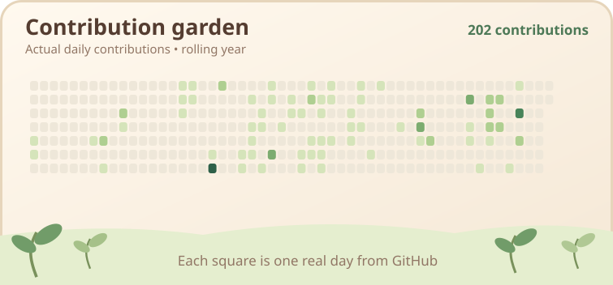
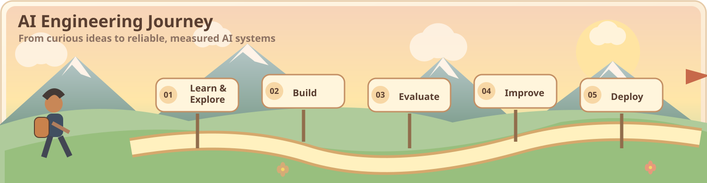
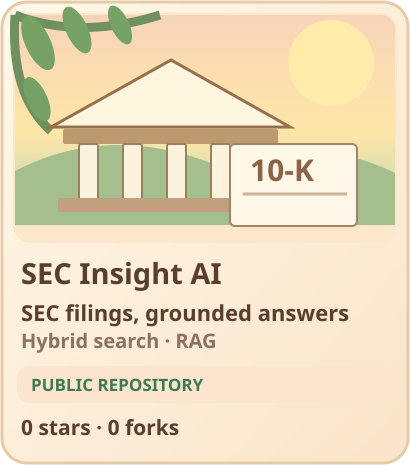
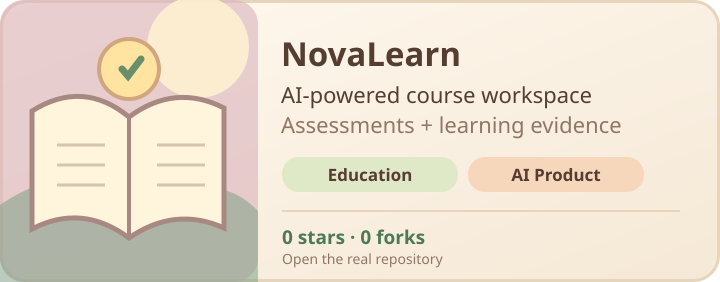
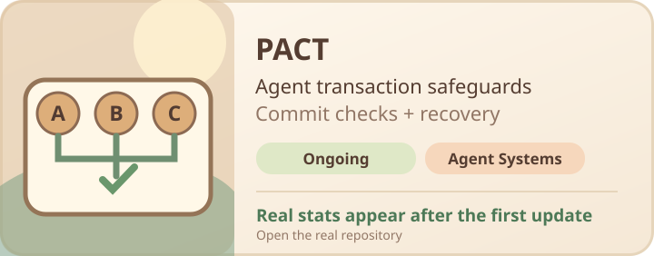
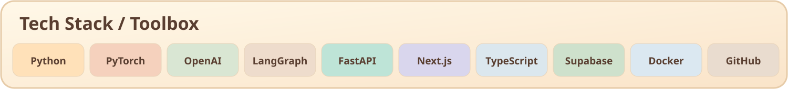

<h2>Hey there! I'm Bijay Thakur 👋</h2>

Building thoughtful AI systems that turn complex problems into useful, reliable products.

<b>AI engineering</b> · <b>Applied ML</b> · <b>Full-stack products</b> · New York · Computer Science @ Queens College

### 🌱 Contribution Garden

Drawn from GitHub's contribution calendar. Refreshed automatically by GitHub Actions every 30 minutes when GitHub's scheduled runner executes; GitHub image caching can delay when you see an update.

### 🏔️ My AI Engineering Journey

### 📊 At a Glance

### ✨ Featured Projects — made with care

These are real public repositories, each card opens its source code. **PACT is ongoing.** Stars and forks are read from GitHub; no unsupported accuracy, test-count, production-readiness, or evaluation claims are displayed.

### 🛠️ Tools around my desk

Thanks for visiting. I care about thoughtful interfaces, rigorous evaluation, and engineering that survives the real world.

